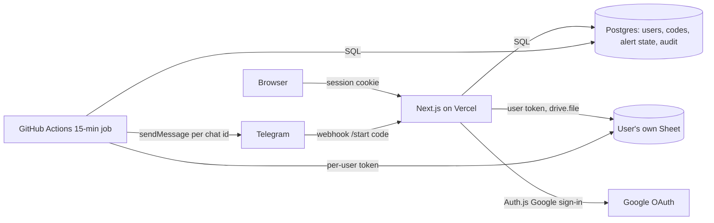

# Plan — multi-user Google sign-in (own Sheet + small database)

Status: PLAN ONLY. No code is changed. Approve before step 1 starts.

## Contents
1. Goal
2. User flows
3. Architecture
4. Data
5. Steps
6. Security
7. What breaks / migration of owner data
8. Setup the user must do
9. Deploy dependencies and rollback
10. Open questions
11. Make it easy
12. Engaging alerts (optional)
- Log

Facts marked **[verified: …]** were checked at the named source on 2026-11-22. All other library facts are open questions (section 10).

## 1 Goal
- Many people can use the app. Each person signs in with Google.
- The app makes one "DSE Trade Helper" Sheet in that person's own Drive. Their trades, plans, limits and watchlist live there.
- A small database keeps only what the app needs to find that Sheet and send alerts.
- Each person connects their own Telegram. The 15-minute alert job sends each person only their own alerts.
- People who do not sign in keep using browser mode, as today.
- The owner's current Sheet moves into the owner's account. Then the shared trades key goes away.

## 2 User flows

**2.1 Signed out.** No change. Data stays in `localStorage` (`components/portfolio-store.ts`, keys `myTrades`, `myPlans`, `myLimits`, `watchlist`). The server only does maths (`/api/portfolio/value`, `/plans`, `/import`).
```
POST /api/portfolio/value  {"trades":[…],"settings":{…},"account":"real"}  → 200 {"holdings":[…],"warnings":[]}
```

**2.2 First sign-in.**
1. The user taps "Continue with Google". A short note shows first: "We only see the one Sheet we create for you."
2. Google consent screen asks for name, email and "see, edit, create files you use with this app" (`drive.file`).
3. Callback: the server adds a `users` row and saves the encrypted refresh token. **Reuse before create:** it uses `users.sheet_id` if set and the Sheet still opens; else it searches the user's Drive for a Sheet this app made earlier (marked with the Drive app property `dseTradeHelper=1`, not in the trash) and reuses it; only when none exists does it create one with tabs `trades`, `plans`, `settings`, `prefs` and set the mark. A lock per user (one `users` row update) stops two tabs creating two Sheets.
   - Same Google account signs in again on any device → same Sheet.
   - User deleted their account here, then signs in again → the old Sheet is found by its mark and reused; nothing is lost.
   - User put the Sheet in the trash → the search skips it and a new Sheet is created; the page says so.
4. If the browser holds data, a card says: "Move 12 trades and 3 plans into your Sheet?" One tap runs the existing `moveBrowserDataToSheet()` (each item keeps its id, so a retry adds nothing twice).
```
users row → {"id":"8f1c…","email":"rahim@gmail.com","sheet_id":"1AbC…","telegram_chat_id":null}
GET /api/trades (session cookie) → 200 {"account":"real","trades":[],"holdings":[]}
```

**2.3 Returning.** Session cookie is valid → the server reads `sheet_id` from the user's row and a fresh access token from the stored refresh token. If Google refuses the refresh token, the page says "Sign in again to reach your Sheet" and offers the button.
```
GET /api/trades → 200 {…}        (expired grant) → 401 {"error":"Sign in again to reach your Sheet.","action":"signin"}
```

**2.4 Connect Telegram.** The page offers a button (phone) and a QR code of the same link (desktop: scan with the phone camera, Telegram opens, tap Start).
1. `POST /api/telegram/link` → `{"url":"https://t.me/DseHelperBot?start=k7Qm2xV9aB3dE5fGhJ1q0w","expiresAt":"2026-11-22T10:10:00Z"}`
2. The code is 16 random bytes, base64url (22 chars). Only its SHA-256 hash is stored, with `user_id`, `expires_at` (10 min), `used_at`. **[verified: core.telegram.org/bots/features — start parameter allows A-Z a-z 0-9 _ -, up to 64 chars; the bot receives `/start <param>` in a private chat]**
3. The user taps Start. Telegram posts to the webhook:
```
POST /api/telegram/webhook   X-Telegram-Bot-Api-Secret-Token: <secret>
{"update_id":901,"message":{"chat":{"id":123456789,"type":"private"},"text":"/start k7Qm2xV9aB3dE5fGhJ1q0w"}}
```
4. The server checks the header, `chat.type == "private"`, hashes the code, finds one unused, unexpired row, saves `telegram_chat_id`, sets `used_at` in the same transaction. The bot replies "Connected ✅ You get your alerts here. Learning aid, not investment advice."
5. The page polls `GET /api/telegram/status` every 3 s while the code lives → `{"connected":true}` → shows "Connected ✓" and a "Disconnect Telegram" button (`DELETE /api/telegram/link` clears the chat id).
- QR: generated in the browser with `qrcode.react` `<QRCodeSVG value={url} marginSize={4} title="Scan to connect Telegram" />`. **[verified: Context7 /zpao/qrcode.react v4.2.0 — `QRCodeSVG`, props `value`, `size`, `marginSize`, `title`; peer react ^19.0.0]**

| Receive `/start` by | Speed | Fit |
|---|---|---|
| **Webhook** (recommended) | Instant | Vercel gives public HTTPS. Secret header check exists. One webhook per bot. |
| 15-min job + `getUpdates` | Up to days: the job runs only 09:00–14:45 Dhaka, Sun–Thu | Telegram keeps updates at most 24 h, so a weekend code is lost. |
Recommended: webhook. **[verified: core.telegram.org/bots/api — getUpdates and webhooks are mutually exclusive; updates kept ≤ 24 h; `secret_token` is sent as header `X-Telegram-Bot-Api-Secret-Token`, 1-256 chars of A-Z a-z 0-9 _ -]**

**2.5 Delete my account.** Settings → "Delete my account" → type `DELETE` → `DELETE /api/account`.
```
→ revoke Google token → delete users row (codes and alert state cascade) → audit "account_deleted" → sign out
→ 200 {"deleted":true,"note":"Your Sheet stays in your Google Drive. You can delete it there."}
```

## 3 Architecture

- Session: Auth.js v5, `session.strategy: "jwt"`, no adapter. The cookie holds only our user id. **[verified: authjs.dev/concepts/session-strategies — default is an encrypted JWT in an HttpOnly cookie; an adapter switches the default to database sessions]**
- Refresh token: kept only in our DB, encrypted. One helper `googleAccessToken(userId)` serves web routes and the job. Same refresh call as the Auth.js guide (`grant_type=refresh_token` to `https://oauth2.googleapis.com/token`; keep the old refresh token when Google sends none). **[verified: authjs.dev/guides/refresh-token-rotation]**
- Google provider: `authorization.params = { access_type: "offline", prompt: "consent" }`. **[verified: authjs.dev/reference/core/providers/google — Google gives a refresh token only on the first sign-in unless `prompt: "consent"` forces it; that asks for consent on every sign-in]**

## 4 Data
**Postgres** (plain SQL migrations, no ORM):

| Table | Columns |
|---|---|
| `users` | `id uuid pk`, `google_sub text unique not null`, `email text not null`, `sheet_id text`, `refresh_token_enc bytea`, `token_key_version smallint`, `telegram_chat_id bigint unique`, `alert_prefs jsonb default '{}'`, `created_at`, `last_sign_in_at` |
| `telegram_link_codes` | `code_hash text pk`, `user_id uuid fk users on delete cascade`, `expires_at timestamptz`, `used_at timestamptz` |
| `alert_state` | `user_id uuid pk fk on delete cascade`, `state jsonb` (today's `NotifyState`: `sent`, `actions`, `lastRun`, `lastSent`, `pending`, `lastError`, `budget`) |
| `audit_log` | `id bigserial`, `user_id uuid` (no FK, kept after delete), `event text`, `at timestamptz`, `detail jsonb` (no email, no token) |
| `rate_limits` | `key text pk` (e.g. `link:<user_id>`), `window_start timestamptz`, `count int` |

**Sheet tabs** (same layout as `lib/sheets.ts` today): `trades` (`id, date, code, side, quantity, price, commission, note, source, created_at, account`), `plans` (`id, code, quantity, bought_now, target_price, until, note, status, created_at`), `settings` (`code, stop_pct, target_pct`), new `watchlist` (`code`).

## 5 Steps
1. **Headline:** sign in with Google; the app makes the user's Sheet; `/api/trades` reads and writes that Sheet by session. verify: two test Google accounts each add a trade; each sees only its own row, in its own Drive.
2. Make `lib/sheets.ts` and `lib/trades-service.ts` per user: key the token cache, `tabSetups` and the `serial` queue by sheet id (all are global today). verify: unit test runs two sheet ids in parallel; no cross-talk.
3. Move plans, settings, import, watchlist and `notify/status|test` routes from `tradesRoute` key check to a `userRoute` session check. verify: every route → 401 signed out, 200 with own data signed in.
4. Isolation and security test suite (section 6.3). verify: all items pass in `npm test` and Playwright.
5. Client mode = signed in ? `sheet` : `browser`; one-tap "Move my browser data in". verify: Playwright moves 3 trades and 1 plan; browser store empties; a second run adds nothing.
6. Connect Telegram: codes table, link/status/disconnect routes, webhook, button + QR. verify: real phone scan connects in < 30 s; expired and reused codes are refused.
7. Per-user alert job: `runNotifier(user)`; state in `alert_state`; `notify-once.ts` loops connected users; drop the Actions cache step. verify: dry run with 2 users sends each its own alerts; one user's Sheet failure does not stop the next.
8. Delete my account. verify: rows gone, Google grant revoked, Sheet still in Drive, audit row present.
9. Owner migration script (section 7). verify: row counts per tab equal; spot-check 5 trades.
10. Retire `TRADES_API_KEY`, `lib/dev-key.ts`, the key box, `GOOGLE_SHEET_ID`, the service account, `TELEGRAM_CHAT_ID`. verify: `grep -r TRADES_API_KEY` finds nothing; all tests green.
11. Make it easy (section 11). verify: timed phone run < 2 min.
12. Optional engaging alerts (section 12), one item per release. verify: per item.

## 6 Security
**6.1 Requirements** (each has a test in 6.3)
- S1 Every API finds the user only from the server session. It never takes a user id or sheet id from the request.
- S2 Sheet id comes only from `users.sheet_id` of the session user.
- S3 Refresh tokens: AES-256-GCM (`node:crypto`), random 12-byte IV per value, stored `iv|tag|ciphertext`. Key `TOKEN_ENC_KEY` in env. Rotation: add new key as current, keep old as `TOKEN_ENC_KEY_PREV`, re-encrypt rows on read or by script (`token_key_version`), then drop the old key.
- S4 Scopes: `openid email profile` + `drive.file` only. No full Drive, no Sheets-wide scope.
- S5 Telegram codes: single use, 10-min expiry, bound to the user who made them, stored hashed; new code voids the user's older ones.
- S6 Webhook: refuse without the exact secret header (constant-time compare); private chats only.
- S7 CSRF: Auth.js handles sign-in and sign-out (double submit cookie) **[verified: authjs.dev/reference/nextjs/react getCsrfToken]**. Our mutations refuse `sec-fetch-site: cross-site` (as `browserRoute` does today) and need `content-type: application/json`.
- S8 Rate limits (DB counter): sign-in callback 10/min per IP, link codes 5/hour per user, mutations 60/min per user, webhook 30/min per chat.
- S9 Logs: no email, token, code, chat id or Sheet id. Errors log the user's uuid only; the exception is the last argument.
- S10 Audit log: `sign_in`, `sheet_created`, `telegram_connected`, `telegram_disconnected`, `account_deleted`, `owner_migrated`.
- S11 Delete wipes DB rows and revokes the Google token.
- S12 DB roles: app role has SELECT/INSERT/UPDATE/DELETE on the 5 tables only; a separate migration role owns DDL.
- S13 Dependency audit (`npm audit`) and secret scanning on the repo before launch.

**6.2 Threat model**

| Threat | Mitigation | Test |
|---|---|---|
| User A reads B's trades by guessing a trade id | S1, S2: lookups run only inside A's Sheet | A calls `GET/PUT/DELETE /api/trades/<B's id>` → 404, B's row unchanged |
| A sends `sheetId` or `userId` in the body | Body fields ignored | Request with B's sheet id writes to A's Sheet only |
| Shared cache leaks across users | Step 2 keys caches by sheet id | Parallel two-user unit test |
| Stolen DB dump | S3 encryption, key not in DB | Row bytes do not contain the token; decrypt fails without key |
| Code replay or theft | S5 | Reused code → refused; code from user A cannot link to B |
| Forged webhook | S6 | Missing or wrong header → 401, no DB change |
| Cross-site form post | S7 | `sec-fetch-site: cross-site` → 403 |
| Brute force or spam | S8 | 6th link code in an hour → 429 |
| Secrets in logs | S9 | Grep test log output for token, email and code patterns → none |

**6.3 Launch checklist** — all must pass: every 6.2 row; signed-out → 401 on each private route; delete flow (S11); key rotation dry run (S3); `npm audit` no high/critical; secret scan clean; least-privilege role checked with a DDL attempt that fails.

## 7 What breaks / migration of owner data
Breaks:
- `x-trades-key` header and `TRADES_API_KEY` stop working (step 10). Owner's browsers fall back to browser mode until sign-in; the key box goes.
- `lib/dev-key.ts`, `test/dev-key.test.ts`, `test/fuzz-http.test.ts`, `e2e/trades.spec.ts`, `e2e/planner.spec.ts`, `components/trades-client.tsx`, `app/page.tsx` use the key → update in steps 3 and 10.
- `lib/notify.ts` reads one global Sheet and one `TELEGRAM_CHAT_ID`; state file `web/data/notify-state.json` via Actions cache → replaced by `alert_state` (step 7).
- Laptop server timer (`startNotifier`, `TELEGRAM_SCHEDULE`) → loops users the same way, or stays off.

Owner data: `drive.file` cannot open a Sheet the app did not create. So **migrate, do not adopt** (recommended). One script reads the old Sheet with the service account and writes each tab into the owner's new Sheet with the owner's token, keeping ids. The old Sheet stays untouched as a backup. The owner's chat id and `notify-state.json` copy into the owner's `users` and `alert_state` rows. Adopting via Google Picker is an open question.

## 8 Setup the user must do
1. Google Cloud: OAuth consent screen (app name, support email, privacy policy URL, scopes from S4); OAuth client "Web application" with redirect URIs `https://<each domain>/api/auth/callback/google` and `http://localhost:3000/api/auth/callback/google`.
2. Database: create Postgres (e.g. Neon via Vercel Marketplace); make the app role and migration role (S12).
3. Telegram: keep the bot; note its username; call `setWebhook` once with the URL and secret.
4. Vercel env vars (each project): `AUTH_SECRET`, `AUTH_GOOGLE_ID`, `AUTH_GOOGLE_SECRET`, `DATABASE_URL`, `TOKEN_ENC_KEY`, `TELEGRAM_BOT_TOKEN`, `TELEGRAM_BOT_USERNAME`, `TELEGRAM_WEBHOOK_SECRET`. Migration window only: `GOOGLE_SHEET_ID`, `GOOGLE_SERVICE_ACCOUNT_JSON`.
5. GitHub secrets (notify job): `DATABASE_URL`, `AUTH_GOOGLE_ID`, `AUTH_GOOGLE_SECRET`, `TOKEN_ENC_KEY`, `TELEGRAM_BOT_TOKEN`. Remove after cut-over: `TELEGRAM_CHAT_ID`, `GOOGLE_SHEET_ID`, `GOOGLE_SERVICE_ACCOUNT_JSON`.

## 9 Deploy dependencies and rollback
- Order: DB + migrations → env vars → deploy app with sign-in (key path still on) → owner signs in → migration script → set webhook → switch notify job → remove key path and old secrets.
- New packages: `next-auth@5`, a Postgres driver, `qrcode.react`. Pin exact versions.
- Rollback: until step 10, redeploy the previous commit; the key path and the old Sheet still work, and the old Sheet was never changed. After step 10, rollback needs the old secrets back — keep them in a safe place for 30 days.
- Webhook rollback: `deleteWebhook`. Notify rollback: revert `notify.yml` to the single-chat version.

## 10 Open questions
1. Can `drive.file` create a Sheet with `spreadsheets.create` and edit it via the Sheets API? Spike before step 1.
2. Google Testing mode: test-user cap and refresh-token lifetime; is verification needed for `drive.file` in Production?
3. `prompt: "consent"` on every sign-in: accept, or try `select_account` once a refresh token exists?
4. Free-tier limits of the chosen Postgres (storage, compute hours, connections).
5. Vercel Hobby terms for a multi-user app; function time limits for sign-in plus Sheet creation.
6. GitHub Actions minutes if the repo is private; job runtime as users grow.
7. Two Vercel projects: which one owns the webhook (one per bot)? Do both use one DB?
8. Postgres driver for Vercel functions (verify in docs before use).
9. Google token revoke endpoint and its exact request (verify before step 8).
10. Verify that `drive.file` lets the app list its own files by app property (`files.list` with `appProperties has {key='dseTradeHelper' and value='1'}`) after a new sign-in. The reuse rule in 2.2 depends on it.
10. Auth.js cookie `SameSite` default and `AUTH_URL` need on Vercel (verify).
11. Telegram `callback_data` byte limit and inline keyboard size (verify before 12.3).
12. Audit log retention period.
13. Adopt the owner's Sheet with Google Picker instead of copying?

## 11 Make it easy
- One tap "Continue with Google". No forms, no keys, no Sheet setup: the app makes the Sheet.
- Before Google's screen, one line: "We only see the one Sheet we create for you. Your other files stay private."
- First-run guide, 3 steps with a progress bar: ① Sign in ② Move your browser data in (one tap) ③ Connect Telegram (button or QR).
- Every error says what to do next, e.g. "Google did not answer. Tap Try again." / "This code expired. Tap Connect again."
- Phone first: big buttons; button on phone, QR on wide screens.
- Bangla and English for every new label, through `components/i18n.tsx` and `components/i18n-bn.ts`.
- The trades-key box is removed for normal users.
- Target: landing → first synced trade + Telegram connected in **under 2 minutes** on a phone (timed in step 11).

## 12 Engaging alerts (optional)
All keep the line "Learning aid, not investment advice." Verified features: HTML parse mode (already used in `lib/telegram.ts`), inline keyboards with URL and callback buttons, `answerCallbackQuery` **[verified: core.telegram.org/bots/api-changelog, Bot API 2.0]**.
1. Richer morning summary (M): per-holding ▲/▼ and % today, best and worst mover, distance to plan target.
```
☀️ Morning summary — Sun 23 Nov
Holdings ৳1,24,500 (▲ ৳1,820, +1.5% today)
▲ BXPHARMA +3.2%   ▼ GP −1.1%
🎯 SQURPHARMA plan: 4.1% to target (৳205 → ৳213.5)
[Open portfolio]  [Snooze today]
Learning aid, not investment advice.
```
2. Emoji headlines per alert type (S): 🎯 target hit, ⏰ plan ends tomorrow, ⚠️ review, 💰 take profit, 🧾 last day for dividend.
3. Inline buttons (M): URL button "Open in app" → `/c/<CODE>` or `/portfolio`; callback "Snooze today" handled by the webhook (needs open question 11).
4. End-of-day recap at about 15:15 Dhaka (S): needs one more cron entry in `notify.yml`.
5. Weekly summary on Friday (M): Friday is not a trading day; separate cron.
6. Settings panel (M): choose alert types and quiet hours; stored in `users.alert_prefs`. Today quiet hours are fixed 22:00–08:00 in `lib/notify.ts`.

## Log
- 2026-11-22 — Plan written: Google sign-in (Auth.js v5), own Sheet per user, small Postgres, per-user Telegram by webhook + QR, security model, owner migration. No code changed.
- 2026-11-22: added "reuse before create" for the user's Sheet (2.2) and open question on Drive app-property search.
- 2026-11-23: Step 1 built locally, not committed. Decision (user): no database for now. The encrypted Auth.js cookie (7-day maxAge) holds the Google id, Sheet id and refresh token. A central Google Sheet replaces Postgres later, for per-user Telegram (steps 6-7). New: web/auth.ts, lib/google-user.ts, lib/session-sheet.ts, app/api/auth/[...nextauth]; per-Sheet queues and tab cache in lib/sheets.ts. Notify routes stay owner-key only. Env: AUTH_SECRET, AUTH_GOOGLE_ID, AUTH_GOOGLE_SECRET (+ AUTH_URL=http://localhost:3000 locally). Redirect URIs: http://localhost:3000/api/auth/callback/google, https://dse-trade-helper.vercel.app/api/auth/callback/google. Not done: live sign-in test, Vercel env vars, commit.
- 2026-11-23: Added /privacy and /terms pages (footer links) for the Google OAuth Branding page; a refused Google grant now signs the user out. Pushed to main for Vercel. Google Cloud: still Testing mode; add Vercel env vars AUTH_SECRET, AUTH_GOOGLE_ID, AUTH_GOOGLE_SECRET.
- 2026-11-23: Live sign-in works on Vercel (user made the Sheet). Added "Open my Google Sheet" (session exposes only the Sheet link). Fresh-eye UX fixes: Phone alerts honest per mode (Telegram test only with the owner key), owner password folded, zero counts dropped, footer tap targets. e2e fixture now mocks /api/prefs.
- 2026-11-23: Telegram for every user built (not deployed): Connect Telegram (button + QR), one-time link codes, webhook /api/telegram/webhook, registry tab telegram_users in the owner Sheet (refresh token AES-256-GCM, TOKEN_ENC_KEY), per-user 15-minute job, sign-in renews the saved token. Deploy needs: Vercel TOKEN_ENC_KEY, TELEGRAM_BOT_USERNAME, TELEGRAM_WEBHOOK_SECRET; GitHub secrets TOKEN_ENC_KEY, AUTH_GOOGLE_ID, AUTH_GOOGLE_SECRET; one setWebhook call. Root README added for GitHub.
